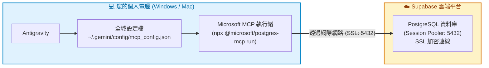

# Supabase 雲端 PostgreSQL 資料庫申請、DBeaver 連線與 MCP Server 設定

> 🎯 學完你會：擁有一個雲端 PostgreSQL，並用 DBeaver 和 AI 助教連上它
>
> 💡 DBeaver 的快捷鍵和常用操作，請見 [DBeaver 速查表](../raspberry_docker安裝/3_dbeaver連線.md#步驟-33dbeaver-常用操作速查表)。

[Supabase](https://supabase.com) 提供免費的雲端託管 PostgreSQL 資料庫，免自己準備硬體或樹莓派，適合隨時隨地練習，也支援透過 AI（Antigravity + MCP）進行純中文自然語言查詢。

---

## 📋 目錄導覽
1. [註冊 Supabase 與建立 PostgreSQL 專案](#1-註冊-supabase-與建立-postgresql-專案)
2. [取得資料庫連線字串 (Session Pooler)](#2-取得資料庫連線字串-session-pooler)
3. [使用 DBeaver 連線至 Supabase](#3-使用-dbeaver-連線至-supabase)
4. [在本機 Antigravity 設定 Microsoft 全域 MCP 連線至 Supabase 資料庫](#4-在本機-antigravity-設定-microsoft-全域-mcp-連線至-supabase-資料庫)
5. [SQL 學習助教實戰 — 讓 AI 看庫解題，學生在 DBeaver 親自執行](#5-sql-學習助教實戰--讓-ai-看庫解題學生在-dbeaver-親自執行)
6. [補充說明：為什麼不直接用 Supabase 官方後台給的 serverUrl 設定？](#6-補充說明為什麼不直接用-supabase-官方後台給的-serverurl-設定)
7. [常見問題與注意事項](#7-常見問題與注意事項)

---

## 1. 註冊 Supabase 與建立 PostgreSQL 專案

### 步驟 1.1：註冊並登入
1. 前往 [Supabase 官網](https://supabase.com)。
2. 點選右上角 **Start your project**，可直接使用 **GitHub 帳號** 快速登入。

### 步驟 1.2：建立新專案 (New Project)
1. 進入後台點選 **New project**。
2. 填入專案設定：
   * **Name**：自訂專案名稱（例如 `postgres-practice`）。
   * **Database Password**：設定資料庫管理員密碼（⭐ **請務必記下此密碼**，後續連線必用）。
   * **Region**：選擇離台灣較近的地區（推薦 `Tokyo (ap-northeast-1)` 或 `Singapore (ap-southeast-1)`）。
   * **Pricing Plan**：選擇 **Free plan**（免費方案即足夠個人與學習使用）。
3. 點選 **Create new project**，系統會在雲端佈署 PostgreSQL（約需 1~2 分鐘）。

---

## 2. 取得資料庫連線字串 (Session Pooler)

在專案主頁面建立完成後：

1. 點選頂端導覽列或首頁的 **Connect** 按鈕。
2. 連線類型選擇 **Session pooler**（⚠️ **非常重要**：Direct Connection 只支援 IPv6，許多家用網路連不上；**Session pooler 支援 IPv4**）。
3. 選擇 **URI** 分頁，複製顯示的連線字串：
   ```text
   postgresql://postgres.[PROJECT-REF]:[YOUR-PASSWORD]@[POOLER-HOST]:5432/postgres
   ```
4. 記下以下關鍵欄位：
   * **Host**：`[POOLER-HOST]`（例如 `aws-0-ap-northeast-1.pooler.supabase.com`）
   * **Port**：`5432`
   * **Database**：`postgres`
   * **User**：`postgres.[PROJECT-REF]`（注意：**後面有一串專案代碼**，不是單純的 `postgres`）
   * **Password**：步驟 1.2 設定的密碼

> [!CAUTION]
> 如果密碼中包含 `@`、`#`、`?`、`&`、`%` 等特殊符號，在 URI 中必須進行 URL 編碼（例如 `#` 需寫為 `%23`）。

---

## 3. 使用 DBeaver 連線至 Supabase

您可以使用本機的 DBeaver 直連 Supabase 雲端資料庫：

1. 開啟 **DBeaver**，點選 **Database → New Database Connection**。
2. 選擇 **PostgreSQL**，點選 **Next**。
3. **【Main 分頁】填寫連線設定：**
   * **Host**：填入 Supabase 的 `[POOLER-HOST]`（例如 `aws-0-ap-northeast-1.pooler.supabase.com`）
   * **Port**：`5432`
   * **Database**：`postgres`
   * **Username**：`postgres.[PROJECT-REF]`
   * **Password**：您設定的資料庫密碼
   * 勾選 **Save password**
4. **【SSL 分頁】：**
   * 勾選 **Use SSL**
   * SSL 模式選擇 **require** 或 **verify-ca**
5. **【PostgreSQL 分頁】：**
   * 勾選 **Show all databases**
6. 點選左下角 **Test Connection**：
   * 連線成功會跳出 `Connected` 提示。
   * 點選 **Finish** 完成建立！

---

## 4. 在本機 Antigravity 設定 Microsoft 全域 MCP 連線至 Supabase 資料庫

在前面步驟中，我們已經在 **Supabase 雲端平台**順利建立了 PostgreSQL 資料庫，並取得 Session Pooler 連線字串與透過 DBeaver 連線成功。

現在，我們使用微軟官方推出的 **`@microsoft/postgres-mcp`**，透過 **`npx`** 免安裝指令直接在全域設定 MCP Server，讓 **Antigravity** 在任何工作區都能隨時連線至 Supabase 雲端資料庫，進行純中文自然語言查庫、架構解析與輔助寫 SQL！

> [!NOTE]
> **為什麼採用微軟 `@microsoft/postgres-mcp` 與全域設定？**
> * **微軟官方開源維護**：由 Microsoft 官方團隊開發，支援豐富的 PostgreSQL 診斷、執行計畫分析與查詢工具。
> * **完全免建 Python 虛擬環境**：透過 Node.js 的 `npx` 工具自動下載執行，**完全不需要建立 `.venv` 或安裝 Python 套件**。
> * **全域一次設定，處處可用**：寫入 `~/.gemini/config/mcp_config.json`，開任何專案都能直接調用。
> * **設定檔獨立且安全**：MCP 設定與連線密碼儲存在您本機的個人全域目錄下，**絕不會被誤加入 Git 提交推送到公開的 GitHub 專案**，安全性大幅提升！
> * **免建立 Profile 直接連線**：依據微軟官方的 [Connecting without a profile](https://github.com/microsoft/postgres-mcp/blob/main/USAGE.md#connecting-without-a-profile) 規範，透過環境變數 `POSTGRES_MCP_CONNECTION_STRING` 直接傳入連線字串。

---

## 🏗️ 連線運作架構



---

## 步驟 4.1：請 Antigravity 檢查與安裝 Node.js（附帶 `npx`）

微軟官方的 `@microsoft/postgres-mcp` 是透過 npm 發行的工具，執行時使用 **`npx`**。

您完全不需要自己手動開終端機或下載安裝檔，直接在 Antigravity 聊天框發送以下中文指令：

> 「請幫我檢查這台電腦有沒有安裝 Node.js（包含 `npx`）。如果沒有安裝，請幫我自動下載並安裝好最新的 Node.js LTS 版本，並確認 `node -v` 與 `npx -v` 安裝成功。」

* **AI 自動化成果**：Antigravity 會自動辨識您的作業系統（Windows 或 Mac）、呼叫適當的套件管理工具（如 Mac 的 Homebrew 或 Windows 的 winget）自動完成安裝，並在完成後驗證輸出版本號！

---

## 步驟 4.2：請 Antigravity 設定全域 `~/.gemini/config/mcp_config.json`

全域 MCP 設定檔位於使用者的個人家目錄下：
* **Mac / Linux**：`~/.gemini/config/mcp_config.json`（即 `/Users/使用者名稱/.gemini/config/mcp_config.json`）
* **Windows**：`%USERPROFILE%\.gemini\config\mcp_config.json`（即 `C:\Users\使用者名稱\.gemini\config\mcp_config.json`）

### 🌟 讓 Antigravity 自動幫你設定（複製貼上自然語言）

您完全不需要手動翻找隱藏資料夾與編輯 JSON，直接複製貼上以下指令給 Antigravity（請自行替換密碼、專案代碼與 Pooler Host）：

> 「請幫我在全域設定檔（Mac/Linux 為 `~/.gemini/config/mcp_config.json`，Windows 為 `%USERPROFILE%\.gemini\config\mcp_config.json`）中設定微軟的 `supabase-postgres` MCP Server：
> 1. command 使用 `npx`
> 2. args 為 `["-y", "@microsoft/postgres-mcp", "run"]`
> 3. 環境變數 `POSTGRES_MCP_CONNECTION_STRING` 設定為：`postgresql://postgres.[PROJECT-REF]:<您的密碼>@[POOLER-HOST]:5432/postgres?sslmode=require`」

* **AI 自動化成果**：Antigravity 會自動辨識作業系統並定位設定檔路徑，自動建立或覆寫標準 JSON 設定，格式精確無誤！

---

### 1. 設定內容檢閱（無 Profile 模式）

根據微軟官方文件，在不需要本機 Keyring 憑證管理的環境下，直接設定環境變數 `POSTGRES_MCP_CONNECTION_STRING` 即可：

```json
{
  "mcpServers": {
    "supabase-postgres": {
      "command": "npx",
      "args": [
        "-y",
        "@microsoft/postgres-mcp",
        "run"
      ],
      "env": {
        "POSTGRES_MCP_CONNECTION_STRING": "postgresql://postgres.[PROJECT-REF]:[YOUR-PASSWORD]@[POOLER-HOST]:5432/postgres?sslmode=require"
      }
    }
  }
}
```

> [!TIP]
> 如果希望關閉使用度遙測回傳，可以在 `args` 中加上 `"--no-telemetry"`：
> ```json
> "args": ["-y", "@microsoft/postgres-mcp", "run", "--no-telemetry"]
> ```

---

### 2. 關鍵參數說明

1. **`"command": "npx"`**：
   使用 Node.js 的免安裝執行工具，全自動下載最新版本的微軟 MCP 套件並在記憶體中啟動。
2. **`"args": ["-y", "@microsoft/postgres-mcp", "run"]`**：
   * `-y`：自動確認下載，免去互動提示。
   * `@microsoft/postgres-mcp`：微軟官方發布的套件名稱。
   * `run`：啟動 MCP stdio 監聽服務。
3. **`"POSTGRES_MCP_CONNECTION_STRING"`**：
   微軟官方指定用來直接連線的環境變數名稱，格式為標準的 libpq 連線字串：
   ```text
   postgresql://【使用者帳號】:【密碼】@【Pooler 主機位址】:【埠號】/【資料庫名稱】?sslmode=require
   ```

| 欄位片段 | 代表意義 | 範例與白話說明 |
|---|---|---|
| `postgresql://` | **連線協定** | 指定連線至 PostgreSQL 資料庫 |
| `postgres.[PROJECT-REF]` | **帳號** | Supabase 專案帳號（包含專案代碼，如 `postgres.abcdefghijklm`） |
| `:密碼` | **密碼** | 步驟 1.2 建立專案時設定的管理員密碼 |
| `@[POOLER-HOST]` | **主機位址** | 步驟 2 取得的 Session Pooler 主機（例如 `aws-0-ap-northeast-1.pooler.supabase.com`） |
| `:5432` | **連接埠** | PostgreSQL 預設服務埠號 `5432` |
| `/postgres` | **資料庫名稱** | 目標資料庫名稱（預設為 `postgres`） |
| `?sslmode=require` | **SSL 加密連線** | ⚠️ **雲端連線必備**，強制啟用 SSL 加密連線確保安全性 |

---

## 步驟 4.3：重新載入與連線驗證

儲存設定後，**重新載入視窗**（或重開 Antigravity），即可在聊天框直接對 AI 提問測試：

1. **查看資料庫狀態**：
   > 「請使用 `supabase-postgres` 連線到我的 Supabase 資料庫，幫我列出目前所有的資料表。」
2. **查詢連線版本**：
   > 「請告訴我目前連線的 PostgreSQL 版本是什麼？」

當看到 Antigravity 自動調用微軟的 `postgres` MCP 工具並回傳資料庫內容時，就代表全域設定已成功運作！

---

## 5. SQL 學習助教實戰 — 讓 AI 看庫解題，學生在 DBeaver 親自執行

在學習 SQL 的過程中，我們建議將 AI 視為最強大的**「專屬 SQL 助教」**：它看得到 Supabase 雲端資料庫的現況，能精確教你寫 SQL、分析結構，而學生親自在 DBeaver 中敲 SQL 執行，真正練就紮實的基本功！

請依序嘗試以下情境，體驗身歷其境的 SQL 輔助學習：

---

### 🔍 情境 1：請 AI 查看現有資料庫結構並詳細講解（Schema 探索）
直接對 Antigravity 說：
> 「請連線我的 Supabase 資料庫，幫我檢查目前資料庫裡有哪些資料表？並挑一張表詳細列出它的所有欄位、資料型態（Data Type）與主鍵設定，教我該怎麼看懂這張表的架構。」

* **直觀成果**：AI 會調用微軟 MCP 讀取 Supabase 的資料庫架構（Context），以整齊的 Markdown 表格列出欄位名稱與型別（如 `VARCHAR`、`INTEGER`、`TIMESTAMP`），並用白話文解釋各欄位用途。

---

### 💡 情境 2：提出查詢需求，請 AI 教導撰寫 SELECT 語法（學生在 DBeaver 執行）
想查特定條件的數據卻卡關時，對 Antigravity 說：
> 「我想在 Supabase 資料庫中查詢符合以下條件的資料：
> 1. 篩選出特定的分類或分數及格的紀錄
> 2. 依照時間或分數由大到小排序（DESC）
> 3. 只取前 5 筆
>
> 請不要直接幫我跑，請教我這段 SQL 語法該怎麼寫？並逐行詳細解釋 `SELECT`、`WHERE`、`ORDER BY` 與 `LIMIT` 的用法。」

* **直觀成果**：AI 會根據現有資料表結構，寫出完全正確的 SQL 語法，並提供清晰易懂的關鍵字教學。
* **學生動手練**：學生將 AI 提供的 SQL 複製，貼到本機 **DBeaver** 的 SQL 編輯器中按下執行（Ctrl + Enter），親眼看到查詢結果！

---

### ✍️ 情境 3：想新增或修改資料，請 AI 教寫語法並解釋防呆觀念
學習資料修改（DML）時，對 Antigravity 說：
> 「如果我想在資料庫中把某筆紀錄更新，請教我正確的 `UPDATE` 語法該怎麼寫？另外請特別提醒我，撰寫 `UPDATE` 時如果不小心漏掉什麼子句會造成嚴重的災難？」

* **直觀成果**：AI 會示範標準 `UPDATE 表名 SET 欄位 = 值 WHERE 條件;` 語法，並強烈警告學生：**「千萬不能漏掉 WHERE 條件，否則整張表的資料都會被一起改掉！」**
* **學生動手練**：學生理解觀念後，在 DBeaver 中親自執行修改，並用 `SELECT` 驗證數據變更。

---

### 🚀 情境 4：效能與查詢計畫分析（微軟 MCP 進階專長）
當資料量變多、想知道查詢效率好不好時，對 Antigravity 說：
> 「請幫我分析這段查詢語法在目前資料庫中的執行計畫（EXPLAIN），並告訴我有沒有需要加上索引（Index）來加速？」

* **直觀成果**：微軟官方的 `@microsoft/postgres-mcp` 內建完整的資料庫診斷與查詢分析工具，AI 能調用工具深入分析 SQL 執行成本（Cost）並給出優化建議！

> [!TIP]
> **教學心法總結**：
> 不要把大腦完全交給 AI 盲目代工，而是把 AI 當作隨身家教——**「AI 隨時看庫教學、學生親自動手在 DBeaver 敲 SQL 驗證」**，學習效果最佳且記憶最深刻！

---

## 6. 補充說明：為什麼不直接用 Supabase 官方後台給的 `serverUrl` 設定？

在 Supabase 後台的 Connect 選單中，您可能會看到官方提供類似這樣的 MCP 設定：
```json
{
  "mcpServers": {
    "supabase": {
      "serverUrl": "https://mcp.supabase.com/mcp?project_ref=...&features=docs,account,database..."
    }
  }
}
```

為什麼本課程建議使用 `npx` + `POSTGRES_MCP_CONNECTION_STRING`（微軟官方套件），而不是官方的這個 `serverUrl` 呢？

| 比較項目 | 課程採用的微軟 `@microsoft/postgres-mcp` (推薦) | Supabase 官方的 `serverUrl` |
|---|---|---|
| **本質與目的** | **專注於 PostgreSQL 資料庫與 SQL 操作** | **整個 Supabase 雲端平台的後台管理介面** |
| **教學一致性** | ⭐⭐⭐ **極佳**：無論連樹莓派 Docker 還是連 Supabase，AI 工具完全一樣，操作心智模型 100% 統一。 | ❌ **不一致**：樹莓派不能用此網址，學生會面臨兩套完全不同的工具名稱與行為。 |
| **AI 聚焦度** | 只提供標準的 SQL 查詢、綱要與分析工具，AI 不會分心。 | 會把查看 Logs、部署 Edge Functions、管理 Storage、查 API 文件等 20 多個管理工具通通塞給 AI，容易干擾 AI 寫 SQL。 |
| **身分驗證** | 只需資料庫連線字串，隨開隨用。 | 通常需要額外進行 Supabase 平台的 OAuth 授權登入。 |

> 💡 **結論**：本課程的核心是學會 **PostgreSQL 與 SQL 語法**，因此使用標準的微軟官方 `@microsoft/postgres-mcp` 最乾淨、最直觀，也能無縫切換本機、樹莓派與雲端資料庫！

---

## 7. 常見問題與注意事項

1. **免費版專案自動休眠：**
   * Supabase 免費專案若連續 7 天沒有存取，會自動進入「休眠狀態（Paused）」。
   * 若 DBeaver 或 MCP 連不上，請登入 Supabase 後台點選 **Restore project**，約 1 分鐘後即可恢復正常。
2. **連線逾時 (Timeout)：**
   * 請確認使用的是 **Session pooler (IPv4)** 的主機位址，而非 Direct connection (IPv6)。
3. **密碼安全性與全域設定保護：**
   * 全域設定檔（`~/.gemini/config/mcp_config.json`）獨立儲存於您的本機個人家目錄，不會被 Git 追蹤或推送到 GitHub，確保密碼安全不外洩。

👉 **下一步：[第 2 章：匯入範例資料庫](../範例資料庫/README.md)**
