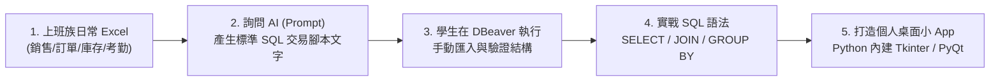

# 範例資料庫與實戰應用總覽

在學習 SQL 與資料庫的過程中，**「範例資料庫」是決定學習成效的關鍵核心**。  
很多上班族學員在課堂上聽得懂，但回家後面對自己工作上複雜的 Excel，卻不知道如何下手。

本專案的核心教學理念是：  
**「讓學生回家後都能動手實作，將日常上班用到的 Excel 透過 AI 轉換為關聯式 SQL 交易檔，並以在自己電腦上打造個人版桌面小 App（Tkinter / PyQt）為終極目標！」**

---

## ⚠️ 核心教學規範：嚴禁 MCP 自動代勞，扎實學習手寫 SQL

1. **所有的 Prompt，嚴禁讓 MCP 在背後直接代勞自動建庫**：
   - 學生學習 SQL 的關鍵在於：親眼看懂每一條 DDL（`CREATE TABLE`、主鍵、外來鍵約束）與 DML（`INSERT INTO ... VALUES`、`SELECT ... JOIN`）。
   - Prompt 僅用於引導 AI 產出純 SQL 交易檔文字，由學生**親自在 DBeaver 執行**。
2. **拒絕線上架站繁瑣，聚焦個人本機桌面小 App**：
   - 不使用需要雲端部署、架伺服器的線上版（如 Web / Streamlit）。
   - 全面採用 **Tkinter**（Python 內建，免安裝繁雜環境，雙擊 `.py` 立即跑出視窗）或 **PyQt**，做出在自己電腦上即開即用的個人管理小工具。
3. **Python 程式中全數手寫 SQL**：
   - 在桌面 App 的按鈕與表格背後，使用 `psycopg2` 撰寫原生 SQL（`cursor.execute("SELECT ...")`），讓學生深刻體會「手寫 SQL 如何驅動視窗畫面」。

---

## 🌟 核心特色：從 Excel 痛點到個人桌面小 App

👉 **詳細實作指南與 Prompt 提示詞範本**：  
請參閱專屬文件：📖 **[從 Excel 用 AI 生成 SQL 交易檔與 App 產品規劃指南](./從Excel用AI生成SQL交易檔與App產品規劃指南.md)**

---

## 🧭 該用哪一個範例？

| 範例 | 語言 | 檔案形式 | 核心教學目的 | 最後可做成哪些個人桌面小 App？ |
|---|---|---|---|---|
| ☕ **[連鎖門市月報表](./excel範例/連鎖門市月報表/從Excel跨月到SQL整合.md)** | 中文 | Excel / CSV / .sql | **上班族首選**：體驗「每月複製一份 Excel」的痛點，學習跨月營收整合 | **[門市店長營運分析桌面小 App](#1-連鎖門市銷售報表--門市店長營運分析桌面小-app)**（營收走勢、熱門商品 TOP 5、VIP 常客名單） |
| 🛒 **[Excel 正規化對照](./從Excel到關聯資料庫_正規化.md)** | 中文 | Excel (單/多Sheet) | **概念核心**：從單一工作表到 3NF 多表關聯（`shop.sql`） | **[電商訂單履約與客戶 CRM 視窗工具](#2-網路商店電商訂單--電商訂單履約與客戶-crm-視窗工具)**（訂單流水線、客戶 RFM 分群） |
| ⭐ **[繁體中文範例庫](#1-繁體中文範例資料庫一鍵建庫)** | 中文 | `.sql` 交易腳本 | **初學者一鍵建庫**：咖啡門市、網路商店、學校選課、圖書館 | **[校園智慧選課小工具](#3-學校選課--校園智慧選課與學分審查桌面小工具)**、**[圖書館借閱與罰款計算機](#4-圖書館借閱--圖書借還流通與逾期罰金計算機)** |
| 🚀 **[巨量資料產生器](#2-巨量資料產生器免下載大檔-10-萬筆)** | SQL | `.sql` 函式腳本 | **進階效能實戰**：1 秒自體生成 10 萬筆資料，練習索引與 EXPLAIN | **大數據本機查詢效能壓測** |
| ⛅ **[練習匯入 CSV](#3-練習匯入-csv-專用目前天氣csv)** | 中文 | CSV (22 筆) | **初學者練習匯入**：台灣天氣資料，練習型別與 DDL 對應 | **全台即時天氣查詢小視窗** |

---

## 📱 每個範例檔最後可以做成哪些「個人桌面小 App（Tkinter / PyQt）」

學 SQL 不只是為了下查詢指令，而是為了在自己電腦上打造獨立運作的桌面工具：

### 1. 連鎖門市銷售報表 (`cafe_shop.sql` / 門市月報 Excel)
* **對應桌面小 App**：**門市店長營運分析桌面小視窗**
* **適合技術**：Python 內建 **Tkinter** (`ttk.Treeview`, `ttk.Combobox`) 或 **PyQt5**
* **核心功能說明**：
  1. **跨店營收與月份切換**：下拉選單切換分店與月份，手寫 SQL 一秒計算 Q1 營業額。
  2. **明星熱門品項 TOP 5 表格**：手寫 SQL 多表 JOIN，按銷量由高到低展示品名、分類與銷售額。
  3. **會員 VIP 回購追蹤名單**：運用 `GROUP BY + HAVING` 抓出連續消費 2 個月以上的忠誠常客。
  4. **店員排班績效結算**：統計各店員經手的訂單總金額。
* 🔗 **實戰專案**：本專案已收錄完整規範 👉 [專案 2：門市店長營運分析桌面 App](../app_projects/project2_cafe_dashboard/)

---

### 2. 網路商店電商訂單 (`shop.sql` / 網路商店 Excel)
* **對應桌面小 App**：**電商訂單履約與客戶 CRM 視窗工具**
* **適合技術**：Python 內建 **Tkinter** (雙分頁視窗) 或 **PyQt5**
* **核心功能說明**：
  1. **訂單流水線狀態過濾**：快速篩選處理中、已完成、已取消訂單。
  2. **點擊訂單即時展開明細**：點擊列表中的任一筆訂單，下方手寫 SQL JOIN 即時帶出該單品項明細。
  3. **客戶 RFM 價值模型自動分群**：
     * **R (Recency)**：最近一次下單天數
     * **F (Frequency)**：累計下單次數
     * **M (Monetary)**：累計消費總額  
     自動為客戶標記「核心 VIP」或「即將流失客」。
* 🔗 **實戰專案**：本專案已收錄完整規範 👉 [專案 3：電商訂單履約與客戶 CRM](../app_projects/project3_shop_crm/)

---

### 3. 學校選課 (`school.sql`)
* **對應桌面小 App**：**校園智慧選課與學分審查桌面小工具**
* **適合技術**：Python 內建 **Tkinter** (`ttk.Combobox`, `messagebox`)
* **核心功能說明**：
  1. **學生每週課表網格視圖**：切換學生學號，直觀展示週一至週五排課時段。
  2. **選課防衝堂即時防呆**：加選時手寫 SQL 檢查時段衝突，衝堂時彈出錯誤提示視窗。
  3. **畢業學分審核進度條**：手寫 SQL 比對必修與選修已修過學分，計算達成率。
* 🔗 **實戰專案**：本專案已收錄完整規範 👉 [專案 4：校園智慧選課小工具](../app_projects/project4_school_enrollment/)

---

### 4. 圖書館借閱 (`library.sql`)
* **對應桌面小 App**：**圖書借還流通與逾期罰金計算機**
* **適合技術**：Python 內建 **Tkinter** 或 **PyQt5**
* **核心功能說明**：
  1. **館藏圖書模糊搜尋視窗**：輸入書名關鍵字，手寫 SQL `LIKE %s` 即時過濾在庫狀態。
  2. **逾期天數與罰金自動計算**：依據 `CURRENT_DATE - due_date` 自動計算累計違規罰款。
  3. **年度熱門借閱排行榜 (RANK 視窗函式)**：統計各分類最搶手的年度書籍 TOP 10。
* 🔗 **實戰專案**：本專案已收錄完整規範 👉 [專案 5：圖書借還流通系統](../app_projects/project5_library_system/)

---

### 5. 金融股市歷史交易 (`init_stock_db.sql`)
* **對應桌面小 App**：**個人投資組合即時監控與增量同步視窗**
* **適合技術**：Python 內建 **Tkinter** + 嵌入式 **Matplotlib**
* **核心功能說明**：
  1. **Cache-Aside 快取與增量同步**：DB 有資料 0.1 秒極速讀取，缺漏歷史才聯網爬取並透過手寫 SQL `ON CONFLICT DO UPDATE` 補齊。
  2. **嵌入式 Matplotlib 折線走勢圖**：即時繪製近 60 天收盤價與 20 日均線 (MA20)。
  3. **歷史報價明細列表**：`ttk.Treeview` 展示詳細開高低收與成交量。
* 🔗 **實戰專案**：本專案已收錄完整規範 👉 [專案 1：股市即時監控與增量同步](../app_projects/project1_stock_market/)

---

## 1. 繁體中文範例資料庫（一鍵建庫）

📁 [中文範例資料庫](./中文範例資料庫/)

專為教學設計，包含完整 DDL（表結構、外來鍵約束、欄位註解）與豐富假資料。**直接複製貼到 DBeaver 執行，1 秒即可建置完成！**

| 資料庫 | 檔案 | 資料表 | 適合練習的手寫 SQL |
|---|---|---|---|
| ☕ **連鎖咖啡門市** *(首推)* | [cafe_shop.sql](./中文範例資料庫/cafe_shop.sql) | 門市、員工、分類、商品、會員、訂單、明細 | 跨月份營業額 (GROUP BY)、門市店員業績 (JOIN)、忠誠顧客 (HAVING) |
| 🛒 網路商店 | [shop.sql](./中文範例資料庫/shop.sql) | 分類、商品、會員、訂單、訂單明細、員工 | SELECT、WHERE、JOIN、GROUP BY、日期函式、自我連結 |
| 🎓 學校選課 | [school.sql](./中文範例資料庫/school.sql) | 學系、教師、學生、課程、選課 | 多對多 JOIN、LEFT JOIN、HAVING、子查詢、CASE WHEN |
| 📚 圖書館借閱 | [library.sql](./中文範例資料庫/library.sql) | 出版社、作者、書籍、會員、借閱 | 日期計算、IS NULL、LEFT JOIN、視窗函式 RANK |

### 匯入方式（DBeaver）：
1. 在連線底下的 **Databases** 按右鍵 → **Create New Database**（例如 `practice`）。
2. **File → Open File** 開啟 `.sql` 檔，工具列確認連線為 `practice`。
3. 按 `Alt + X` 執行整個檔案，完成建庫。

---

## 2. 巨量資料產生器（免下載大檔，10 萬筆）

📄 **檔案**：[`generate_100k_orders.sql`](./中文範例資料庫/generate_100k_orders.sql)

利用 PostgreSQL 內建的 `generate_series()` 引擎：
* **零網路傳輸**：完全不需要下載或上傳大檔案。
* **極速生成**：在 DBeaver 執行此腳本，**僅需 1~2 秒**，即可動態產生 5 萬筆訂單與 10 萬筆商品明細，專門用來練習索引（INDEX）優化與 EXPLAIN 效能分析！

---

## 3. 練習匯入 CSV 專用：目前天氣.csv

專門保留給學生練習**手動建表與匯入 CSV** 的標準範例檔。

📁 [其它範例csv/目前天氣.csv](./其它範例csv/目前天氣.csv)

| 檔案 | 筆數 | 大小 | 涵蓋型別 |
|---|---|---|---|
| [目前天氣.csv](./其它範例csv/目前天氣.csv) | 22 筆 | 1.9 KB | 城市 (VARCHAR)、時間與時區 (TIMESTAMPTZ)、溫度 (REAL)、文字 (VARCHAR) |

---

## 🔗 下一步與實戰路徑

1. 👉 **[用 AI 將上班 Excel 轉 SQL 交易檔與桌面 App 規劃指南](./從Excel用AI生成SQL交易檔與App產品規劃指南.md)**：將你手邊的真實資料變成專屬實作資料庫！
2. 👉 **[從 Excel 跨月到 SQL 整合教學](./excel範例/連鎖門市月報表/從Excel跨月到SQL整合.md)**：查看職場 Excel 痛點與 SQL 解決方案。
3. 👉 **[實戰專案：個人桌面小 App 開發 (Tkinter / PyQt)](../app_projects/)**：親手用 Python 內建 Tkinter 與 PostgreSQL 手寫 SQL 做出真正獨立運作的桌面工具！
