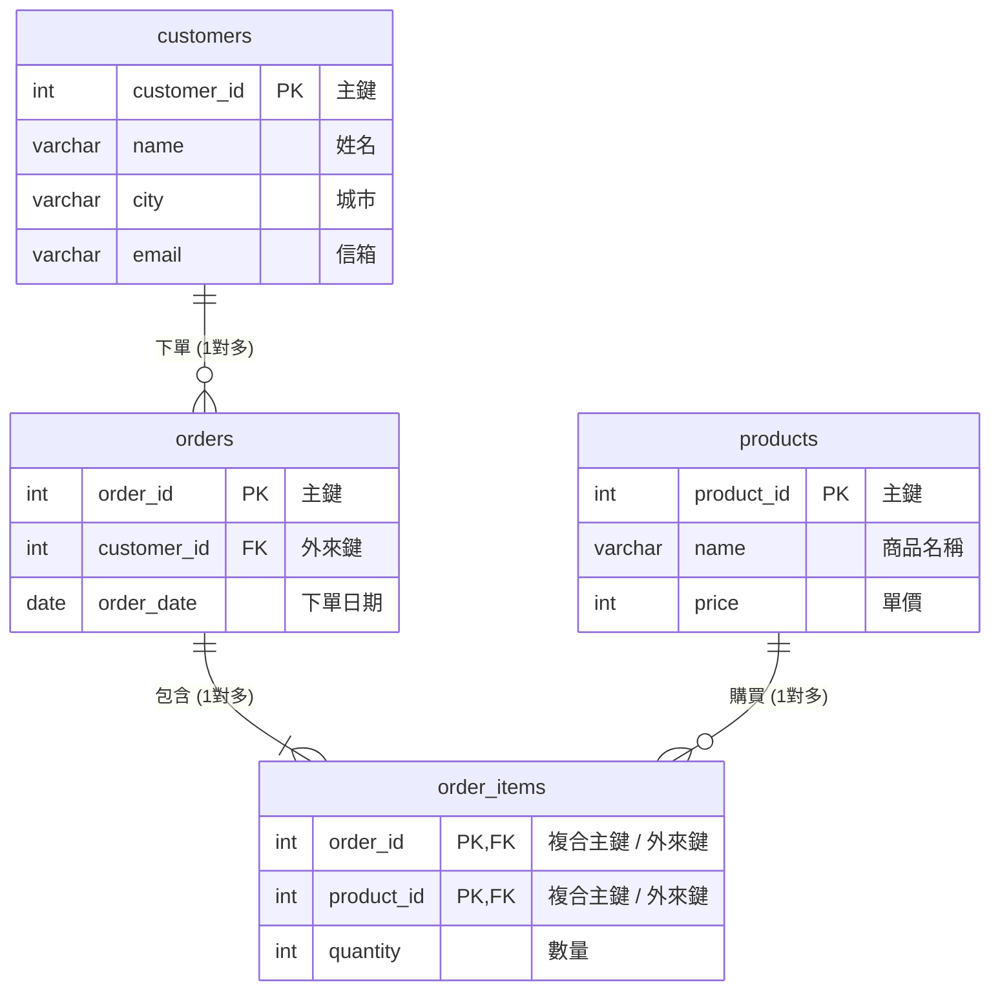

# 從 Excel 到關聯式資料庫：正規化思維教學

很多初學者在剛學資料庫時，最常問的一個問題是：
> **「我在 Excel 裡開一個工作表把所有資料記在一起就好，為什麼需要關聯式資料庫？為什麼要大費周章拆成好幾張表？」**

本篇透過學生最熟悉的 **Excel 工作表** 作為橋樑，帶你親身體驗「一張表記全部」的災難，並透過 **AI 輔助學習資料庫正規化（Normalization）**，最後對照我們的 [`shop.sql` 繁中範例資料庫](./中文範例資料庫/shop.sql)。

---

## 📁 範例檔案下載

我們為本單元準備了兩份對照的實體 Excel 與 CSV 檔案：
1. 📄 **[未正規化_網路商店單一工作表.xlsx](./excel範例/未正規化_網路商店單一工作表.xlsx)**（亦提供 [CSV 格式](./excel範例/未正規化_網路商店單一工作表.csv)）
2. 📊 **[正規化_網路商店多工作表.xlsx](./excel範例/正規化_網路商店多工作表.xlsx)**（含 `customers`、`products`、`orders`、`order_items` 四個 Sheet，並內建 `VLOOKUP` 公式）

---

## 1. 痛點體驗：單一工作表的四大災難

打開 `未正規化_網路商店單一工作表.xlsx`，這是一般人在 Excel 裡最直覺的記帳方式——把訂單、客戶個資、商品資訊全塞在同一個工作表：

| 訂單編號 | 訂單日期 | 付款方式 | 訂單狀態 | 會員姓名 | 會員性別 | 會員生日 | 會員城市 | 會員信箱 | 商品名稱 | 商品單價 | 數量 | 小計 | 痛點說明 |
|:---:|:---:|:---:|:---:|:---:|:---:|:---:|:---:|:---:|:---:|:---:|:---:|:---:|---|
| 1001 | 2024-03-01 | 信用卡 | 已完成 | 陳小華 | 女 | 1995-05-12 | 台北市 | hua@example.com | 保溫鋼杯 | 450 | 2 | 900 | 正常第一筆 |
| 1001 | 2024-03-01 | 信用卡 | 已完成 | **陳小華** | **女** | **1995-05-12** | **台北市** | **hua@...** | 快充行動電源 | 890 | 1 | 890 | 🚨 同訂單第二項商品：個資被迫重寫一次！ |
| 1003 | 2024-03-05 | 貨到付款 | 已完成 | **陳小華** | **女** | **1995-05-12** | **台北市** | **hua@...** | 陶瓷咖啡杯 | 280 | 2 | 560 | 🚨 陳小華又下單：個資再次重複！ |
| 1004 | 2024-03-08 | 信用卡 | 已取消 | 黃雅婷 | 女 | 2001-08-30 | 台中市 | ting@example.com | 無線耳機 | 1290 | 1 | 1290 | 🚨 若取消刪除此列，黃雅婷的個資全蒸發！ |
| *無* | *無* | *無* | *無* | *無* | *無* | *無* | *無* | *無* | 輕量登山背包 | 1580 | *無* | *無* | 🚨 新商品剛進貨沒人買，無法填入表內！ |
| *無* | *無* | *無* | *無* | 張大同 | 男 | 1992-04-18 | 高雄市 | datong@... | *無* | *無* | *無* | *無* | 🚨 新會員剛註冊沒消費，沒有訂單編號！ |

### 這張單一表會帶來的 4 大惡夢：

1. **資料重複冗餘（Data Redundancy）**：
   陳小華買了 3 次東西，她的姓名、生日、電話、信箱就要重複複製貼上 3 次。若有 1 萬筆訂單，硬碟和記憶體都在存重複廢話。
2. **修改異常（Update Anomaly）**：
   如果陳小華搬家到台中市，你必須在幾百列訂單中逐一搜尋修改；只要漏改一列，資料庫裡陳小華就同時住在台北又住在台中，資料直接矛盾！
3. **刪除異常（Delete Anomaly）**：
   黃雅婷是新客人，只買過這一次。如果她要求取消這筆訂單並刪除紀錄，結果**連帶把黃雅婷這個人的會員資料一起刪光了**！
4. **新增異常（Insert Anomaly）**：
   倉庫新進了一款「輕量登山背包」，但還沒有客人下單（沒有訂單編號），這張表就根本無法登記這件新商品！

---

## 2. 🤖 用 AI 輔助學習「正規化法則」

這時候，我們可以把這個未正規化的表格交給 Antigravity AI，讓 AI 帶我們理解標準的正規化步驟：

### 🎯 實戰 Prompt 練習

在 Antigravity 中附加 `未正規化_網路商店單一工作表.csv`，並輸入以下 Prompt：

> **Prompt 範例**：
> 「這是一份用單一 Excel 工作表記錄的網路商店資料。請根據關聯式資料庫的正規化原則（1NF, 2NF, 3NF），向我解釋這張表存在哪些問題？並一步步示範如何將它拆解成符合第三正規化的關聯式資料表結構？」

### 💡 正規化三部曲解析：

* **第一正規化（1NF）**：每個欄位都必須是單一值（不可在一格填多個商品），且每列都有唯一的識別碼。
* **第二正規化（2NF）**：消除部分相依。在多個商品的明細中，商品名稱與單價只依賴「商品編號」，不應該跟「訂單編號」綁在一起，應拆出獨立的 **商品表**。
* **第三正規化（3NF）**：消除遞移相依。會員的生日、城市、信箱只依賴「會員」，不該存在訂單表中，應拆出獨立的 **會員表**。

---

## 3. 解決方案：拆解成 Excel 多工作表（多 Sheet）

經過正規化後，我們把原本的一張大雜燴工作表，拆成 **4 個獨立的工作表**（見 `正規化_網路商店多工作表.xlsx`）：



### 多工作表的好處：
* **獨立管理**：新進商品直接登記在 `products` 工作表，新註冊會員登記在 `customers` 工作表，再也不需要依附訂單！
* **資料乾淨無冗餘**：陳小華的個資只在 `customers` 記一次。下單時，訂單表只需記錄 `customer_id: 1`。
* **修改極簡**：陳小華搬家，只需改 `customers` 裡的一格，所有訂單自動同步！

---

## 4. Excel 的 `VLOOKUP` vs SQL 的 `JOIN`

當資料拆成多個工作表後，要看「某筆訂單是誰買的、買了什麼商品」，該怎麼做？

### 在 Excel 中：使用跨工作表公式
在 `orders` 工作表裡，我們利用 `VLOOKUP` 查會員名稱：
```excel
=VLOOKUP(customer_id, 'customers(會員)'!A:B, 2, FALSE)
```

### 在 SQL 中：使用 `JOIN` 關聯查詢
在關聯式資料庫中，完全不需要寫繁瑣的試算表公式，一句 `JOIN` 就能瞬間把多張表串連：
```sql
SELECT 
    orders.order_id,
    orders.order_date,
    customers.name AS 會員姓名,
    products.name AS 商品名稱,
    order_items.quantity,
    products.price * order_items.quantity AS 小計
FROM orders
JOIN customers ON orders.customer_id = customers.customer_id
JOIN order_items ON orders.order_id = order_items.order_id
JOIN products ON order_items.product_id = products.product_id;
```

---

## 5. 對照我們的範例資料庫：`shop.sql`

你在 `正規化_網路商店多工作表.xlsx` 看到的這 4 個工作表結構，**完全就是本課程繁中範例資料庫 [`shop.sql`](./中文範例資料庫/shop.sql) 的核心骨架**！

* `customers` 工作表 ➡️ `shop.sql` 的 `customers` 資料表
* `products` 工作表 ➡️ `shop.sql` 的 `products` 資料表
* `orders` 工作表 ➡️ `shop.sql` 的 `orders` 資料表
* `order_items` 工作表 ➡️ `shop.sql` 的 `order_items` 資料表

> 🎓 **總結觀念**：
> 1. 前面章節學的 DDL/DML 是在學**「單一資料表（單一 Sheet）的基本操作」**。
> 2. 後面即將進入的關聯資料庫章節，就是學**「如何把多張表透過 Key 串連起來（多 Sheet 的跨表查詢）」**！

