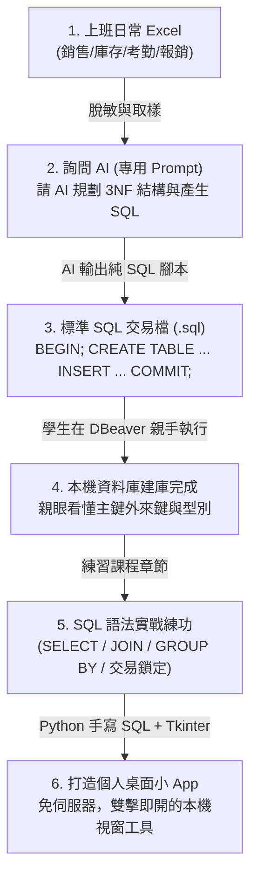

# 職場實戰：如何用 AI 將上班 Excel 轉為 SQL 交易檔與打造個人桌面小 App

許多學員在下課後最常遇到的問題是：
> 「老師上課教的範例我都懂，但我回到公司面對自己電腦裡成堆的 Excel 報表，還是不知道該怎麼建立專屬於自己工作場景的資料庫？」
> 「我們公司每天在用的訂單表、庫存表、排班表，轉成 SQL 之後，我真的能在自己電腦上做出一個不用架站、點擊就能跑的個人桌面小 App 嗎？」

**這份指南就是為了解決這個問題而生！**  
我們設計了一套 **「Bring Your Own Excel（自備工作 Excel）」** 的實作流程：  
學生只需要準備日常上班用的 Excel，透過特定 Prompt 指引 AI 分析結構並產生**具備正規化與交易保護（`BEGIN ... COMMIT`）的 SQL 交易檔**，由學生**親自複製到 DBeaver 手動執行**；後續更可以透過 Python 內建的 **Tkinter** 或 **PyQt**，打造出屬於自己的**「個人版桌面小 App（Desktop GUI）」**！

---

## ⚠️ 核心教學規範：MCP 可以讀取、不可寫入，扎實學會手寫 SQL

1. **不可以叫 MCP 寫入資料庫，但可以讀取**：
   - MCP 可以讀取資料庫的結構和資料；建表、新增、修改、刪除都不可以透過 MCP 執行。
   - 學生學習 SQL 的關鍵在於：親眼看過每一條 DDL（`CREATE TABLE`、主鍵、外來鍵約束）與 DML（`INSERT INTO ... VALUES`、`SELECT ... JOIN`）。
   - Prompt 的任務是引導 AI 產出清晰的 SQL 腳本文字，由學生**在 DBeaver 親自動手執行**。
2. **拒絕線上架站繁瑣，聚焦個人本機桌面小 App**：
   - 不使用需要雲端部署、架伺服器的線上版（如 Web / Streamlit）。
   - 全面採用 **Tkinter**（Python 內建，免安裝繁雜環境，雙擊 `.py` 立即跑出視窗）或 **PyQt**，做出在自己電腦上即開即用的個人管理小工具。
3. **Python 程式中全數手寫 SQL**：
   - 在桌面 App 的按鈕與表格背後，使用 `psycopg2` 撰寫原生 SQL（`cursor.execute("SELECT ...")`），讓學生深刻體會「手寫 SQL 如何驅動視窗畫面」。

---

## 🧭 整體學習與落地路徑



---

## 🛠️ 第一階段：把上班 Excel 轉成 SQL 交易檔（4 步驟 SOP）

### 步驟 1：整理並「脫敏」你的 Excel 檔案
在提供給 AI 之前，請務必保護公司機密與個人隱私：
1. **去識別化**：將真實客戶姓名改為「陳小明」、「王大華」，電話改為「0912-345-678」，信箱改為「user@example.com」。
2. **取樣 10~20 筆即可**：不需要把上萬列的 Excel 整個丟給 AI，只需要保留**標題列（Header）**與具代表性的 **10~20 筆資料**。

### 步驟 2：複製「AI 轉 SQL 交易檔專用 Prompt」（不讓 MCP 寫入）
開啟對話框，附加你的 Excel 或 CSV 檔案（或直接複製表格文字），輸入以下提示詞：

```text
你現在是一位資深 PostgreSQL 資料庫架構師與 SQL 教學助教。
我附上了一份我在日常上班中使用的 Excel 資料範例。

【重要教學規範】：你可以用 MCP 讀取資料庫的結構和資料，但不可以透過 MCP 建立或修改資料庫。我需要學習 SQL 語法，請直接在對話中為我產出標準完整的 SQL 程式碼區塊，供我複製至 DBeaver 手動執行。

請針對這份資料執行以下任務：
1. 【問題診斷】：指出這份 Excel 單一工作表存在哪些資料冗餘與異常（1NF / 2NF / 3NF 痛點）。
2. 【關聯資料表設計（DDL）】：
   - 請將它拆解為符合第三正規化（3NF）的 PostgreSQL 關聯資料表。
   - 每個表必須包含適當的主鍵（Primary Key）、外來鍵（Foreign Key）、欄位型別（如 VARCHAR, INT, NUMERIC, TIMESTAMPTZ）、以及適當的約束（NOT NULL, DEFAULT）。
   - 請為每個資料表與主要欄位附上 SQL 註解（COMMENT ON）。
3. 【SQL 交易資料檔（DML）】：
   - 請將我提供的 Excel 資料轉換為標準 SQL INSERT 語法。
   - 必須使用交易區塊包裹（以 BEGIN; 開頭，以 COMMIT; 結尾），確保資料寫入的一致性。
   - 寫入順序必須嚴格遵守外來鍵相依性（先寫入主表，再寫入從表）。
4. 【後續手寫 SQL 查詢練習】：提供 3 個未來這份資料庫可以用在 Python 桌面 App 中的經典手寫查詢（例如 JOIN 查詢明細、GROUP BY 月營收統計、HAVING 篩選條件）。
```

### 步驟 3：AI 產出的標準交易檔長相（範例結構）
AI 會為你產生一份隨附交易保護的完整文字腳本：

```sql
-- ==========================================
-- 學生自備 Excel 轉化之 SQL 交易檔範例
-- ==========================================
BEGIN; -- 開啟交易，任何一步出錯自動 Rollback，絕不留髒資料

-- 1. 建立主表：會員與商品
CREATE TABLE IF NOT EXISTS members (
    member_id SERIAL PRIMARY KEY,
    name VARCHAR(50) NOT NULL,
    phone VARCHAR(20) UNIQUE NOT NULL,
    created_at TIMESTAMPTZ DEFAULT CURRENT_TIMESTAMP
);

CREATE TABLE IF NOT EXISTS products (
    product_id SERIAL PRIMARY KEY,
    name VARCHAR(100) NOT NULL,
    price NUMERIC(10, 2) NOT NULL CHECK (price >= 0)
);

-- 2. 建立從表：訂單與訂單明細（外來鍵約束）
CREATE TABLE IF NOT EXISTS orders (
    order_id SERIAL PRIMARY KEY,
    member_id INT REFERENCES members(member_id),
    order_date DATE NOT NULL,
    status VARCHAR(20) DEFAULT '處理中'
);

CREATE TABLE IF NOT EXISTS order_items (
    item_id SERIAL PRIMARY KEY,
    order_id INT REFERENCES orders(order_id) ON DELETE CASCADE,
    product_id INT REFERENCES products(product_id),
    quantity INT NOT NULL CHECK (quantity > 0),
    unit_price NUMERIC(10, 2) NOT NULL
);

-- 3. 匯入資料（依主從關聯順序寫入）
INSERT INTO members (member_id, name, phone) VALUES
(1, '陳小華', '0912-000-001'),
(2, '林志明', '0912-000-002');

INSERT INTO products (product_id, name, price) VALUES
(101, '經典美式咖啡', 85),
(102, '拿鐵咖啡', 120);

INSERT INTO orders (order_id, member_id, order_date, status) VALUES
(1001, 1, '2024-03-01', '已完成'),
(1002, 2, '2024-03-02', '已完成');

INSERT INTO order_items (order_id, product_id, quantity, unit_price) VALUES
(1001, 101, 2, 85),
(1001, 102, 1, 120),
(1002, 102, 2, 120);

COMMIT; -- 交易成功確認，寫入資料庫
```

### 步驟 4：學生在 DBeaver 親自動手執行
學生將這段 SQL 複製到 DBeaver SQL 編輯器中，按下 `Alt + X` 執行，親眼看著資料表一個個建立，扎實理解資料庫的結構。

---

## 📱 第二階段：範例庫最後做成哪些「個人職場桌面小 App (PyQt5 / Tkinter)」

學 SQL 的目的，不是為了枯燥的考試，而是讓上班族（會計、出納、總務、業務、人資）將手邊繁瑣重複的 Excel 工作，轉化為自己電腦前隨點即用、不用架設網路伺服器的**個人本機桌面管理 App**：

### 1. 💼 會計 / 出納：費用報銷審核與部門預算預警系統 (`expense_tracker.sql`)
* **個人桌面 App**：**企業費用報銷審核與部門預算超支警示系統**
* **技術**：**PyQt5** (專業商務 QSS 風格、QTabWidget 分頁、QTableWidget 即時核銷)
* **核心功能**：
  1. 待審核報銷案件流水線審批（核准/駁回/撥款）狀態切換。
  2. 手寫 SQL 聚合與關聯查詢，即時計算各部門「年度核定預算 vs 累計報銷支出」。
  3. 支出率超過 80% 自動觸發視覺預警，協助出納與會計控管預算。
* 🔗 **實戰專案**：[`app_projects/project1_expense_manager/`](../app_projects/project1_expense_manager/)

---

### 2. 👥 人資 HR：排班差勤、加班與計薪核算工具 (`hr_attendance.sql`)
* **個人桌面 App**：**員工排班打卡核對、加班工時與計薪結算工具**
* **技術**：**Tkinter** (Python 內建免安裝環境、`ttk.Treeview` 差勤網格)
* **核心功能**：
  1. 匯入員工每日打卡時間，手寫 SQL `CASE WHEN` 自動判斷遲到、早退與正常。
  2. 自動計算平日加班與假日加班時數（以勞基法 1.34x / 1.67x 費率試算）。
  3. 月底一鍵結算應發薪資總表（底薪 + 加班費 - 勞健保自付額）。
* 🔗 **實戰專案**：[`app_projects/project2_hr_attendance/`](../app_projects/project2_hr_attendance/)

---

### 3. 🏢 總務：固定資產借還與耗材安全存量管理 (`assets_inventory.sql`)
* **個人桌面 App**：**辦公設備借還登記、逾期追蹤與耗材採購預警系統**
* **技術**：**PyQt5** (多面板互動視窗、`QSplitter` 資產與借閱雙向聯動)
* **核心功能**：
  1. 公司筆電、投影機借還登記，手寫 SQL 篩選逾期未歸還名冊與天數。
  2. 文具與耗材安全存量檢核：庫存低於預警線自動標記「建議採購清單」。
  3. 耗材領用登記自動扣減庫存，完整紀錄各部門領用歷程。
* 🔗 **實戰專案**：[`app_projects/project3_assets_inventory/`](../app_projects/project3_assets_inventory/)

---

### 4. ☕ 門市店長：跨月門市營運分析與員工提成系統 (`cafe_shop.sql`)
* **個人桌面 App**：**門市銷售戰情室與員工銷售業績提成計算機**
* **技術**：**PyQt5** (現代化卡片式 KPI、排行清單與營運圖表)
* **核心功能**：
  1. 跨月份、跨門市營收對比，解決多份 Excel 拼湊痛點。
  2. 手寫 SQL `GROUP BY` 與視窗函式，計算明星商品熱賣排行與滯銷警示。
  3. 員工銷售杯數提成階梯試算，自動產出各店員當月提成獎金明細。
* 🔗 **實戰專案**：[`app_projects/project4_cafe_dashboard/`](../app_projects/project4_cafe_dashboard/)

---

### 5. 🛒 業務 / 電商：業務訂單履約與客戶 CRM 系統 (`shop.sql`)
* **個人桌面 App**：**客戶訂單追蹤、出貨排程與 RFM 價值分群系統**
* **技術**：**Tkinter** (主從明細 Master-Detail、客製化篩選工具列)
* **核心功能**：
  1. 訂單狀態流動管理（待付款 ➡️ 揀貨中 ➡️ 已出貨 ➡️ 已完成）。
  2. 點選客戶即時連動歷史訂單與購買品項，掌握客戶偏好。
  3. RFM 模型試算客戶近期消費活躍度與消費額，標記高價值 VIP 與流失預警名單。
* 🔗 **實戰專案**：[`app_projects/project5_shop_crm/`](../app_projects/project5_shop_crm/)

---

## 🎯 總結：學生的實戰行動清單

1. **挑選日常上班 Excel**：會計報銷、排班打卡、資產清單、銷售紀錄、客戶名單，去識別化後取樣 10~20 筆。
2. **複製專用 Prompt 問 AI**：請 AI 產出純 SQL 交易檔文字（不可以叫 MCP 寫入資料庫）。
3. **在 DBeaver 執行**：按下 `Alt + X`，親手建庫並檢查每一張表的正規化與外來鍵關聯。
4. **手寫 SQL 貫穿學習**：跟著 `SQL語法教學/` 每個章節動手下指令。
5. **打造個人桌面 App**：進入 `app_projects/`，依個人偏好選擇輕量免安裝的 **Tkinter** 或企業級現代介面的 **PyQt5**，寫出自己在電腦上隨點隨開的專屬桌面小 App！
