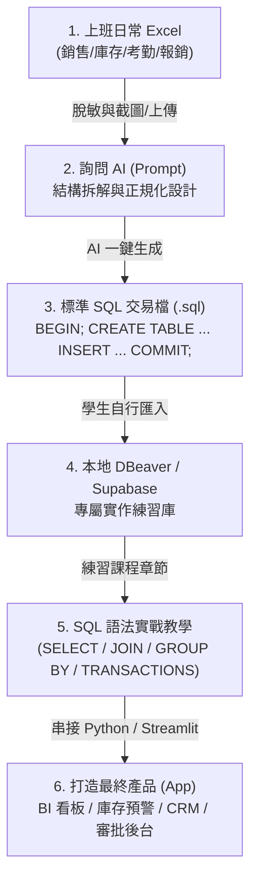

# 職場實戰：如何用 AI 將上班 Excel 轉為 SQL 交易檔與打造 App 產品

許多學員在下課後最常遇到的問題是：
> 「老師上課教的範例我都懂，但我回到公司面對自己電腦裡成堆的 Excel 報表，還是不知道該怎麼建立專屬於自己工作場景的資料庫？」
> 「我們公司每天在用的訂單表、庫存表、考勤表，轉成 SQL 之後，最後真的能做出像樣的軟體產品（App）嗎？」

**這份指南就是為了解決這個問題而生！**  
我們設計了一套 **「Bring Your Own Excel（自備工作 Excel）」** 的實作流程：  
學生只需要準備日常上班用的 Excel，透過特定 Prompt 指引 AI，就能一秒產生**具備關聯正規化與交易保護（`BEGIN ... COMMIT`）的 SQL 交易檔**，並銜接後續的所有 SQL 教學；最後更可以直接把資料庫串接成主管驚豔的 **Streamlit / Web 商業 App 產品**！

---

## 🧭 整體學習與落地路徑



---

## 🛠️ 第一階段：把上班 Excel 轉成 SQL 交易檔（4 步驟 SOP）

### 步驟 1：整理並「脫敏」你的 Excel 檔案
在提供給 AI 之前，請務必保護公司機密與個人隱私：
1. **去識別化**：將真實客戶姓名改為「陳小明」、「王大華」，電話改為「0912-345-678」，信箱改為「user@example.com」。
2. **取樣 10~20 筆即可**：不需要把上萬列的 Excel 整個丟給 AI，只需要保留**標題列（Header）**與具代表性的 **10~20 筆資料**（涵蓋各類不同狀態，如已付款、已取消、不同品項）。

### 步驟 2：複製「AI 轉 SQL 交易檔專用 Prompt」
開啟 Antigravity / Claude / ChatGPT，附加你的 Excel 或 CSV 檔案（或直接複製表格文字），輸入以下提示詞：

```text
你現在是一位資深 PostgreSQL 資料庫架構師與 SQL 教學助教。
我附上了一份我在日常上班中使用的 Excel 資料範例。

請針對這份資料執行以下任務：
1. 【問題診斷】：指出這份 Excel 單一工作表存在哪些資料冗餘與異常（1NF / 2NF / 3NF 痛點）。
2. 【關聯資料表設計（DDL）】：
   - 請將它拆解為符合第三正規化（3NF）的 PostgreSQL 關聯資料表。
   - 每個表必須包含適當的主鍵（Primary Key）、外來鍵（Foreign Key）、欄位型別（如 VARCHAR, INT, NUMERIC, TIMESTAMPTZ）、以及適當的約束（NOT NULL, DEFAULT）。
   - 請為每個資料表與主要欄位附上 SQL 註解（COMMENT ON）。
3. 【SQL 交易資料檔（DML）】：
   - 請將我提供的 Excel 資料轉換為標準 SQL INSERT 語法。
   - 必須使用交易區塊包裹（以 BEGIN; 開頭，以 COMMIT; 結尾），確保資料寫入的一致性。
   - 寫入順序必須嚴格遵守外來鍵相依性（先寫入主表，再寫入從表）。
4. 【後續 SQL 練習情境】：列出 3 個未來這份資料庫可以用來練習的 SQL 經典查詢（例如 JOIN 多表合併、GROUP BY 營收統計、HAVING 篩選條件）。
```

### 步驟 3：AI 產出的標準交易檔長相（範例結構）
AI 會為你產生一份隨附交易保護的完整腳本，例如：

```sql
-- ==========================================
-- 學生自備 Excel 轉化之 SQL 交易檔範例
-- ==========================================
BEGIN; -- 開啟交易，任何一步出錯自動 Rollback，絕不留髒資料

-- 1. 建立主表：會員與商品
CREATE TABLE IF NOT EXISTS members (
    member_id SERIAL PRIMARY KEY,
    name VARCHAR(50) NOT NULL,
    phone VARCHAR(20) UNIQUE NOT NULL,
    created_at TIMESTAMPTZ DEFAULT CURRENT_TIMESTAMP
);

CREATE TABLE IF NOT EXISTS products (
    product_id SERIAL PRIMARY KEY,
    name VARCHAR(100) NOT NULL,
    price NUMERIC(10, 2) NOT NULL CHECK (price >= 0)
);

-- 2. 建立從表：訂單與訂單明細（外來鍵約束）
CREATE TABLE IF NOT EXISTS orders (
    order_id SERIAL PRIMARY KEY,
    member_id INT REFERENCES members(member_id),
    order_date DATE NOT NULL,
    status VARCHAR(20) DEFAULT '處理中'
);

CREATE TABLE IF NOT EXISTS order_items (
    item_id SERIAL PRIMARY KEY,
    order_id INT REFERENCES orders(order_id) ON DELETE CASCADE,
    product_id INT REFERENCES products(product_id),
    quantity INT NOT NULL CHECK (quantity > 0),
    unit_price NUMERIC(10, 2) NOT NULL
);

-- 3. 匯入資料（依主從關聯順序寫入）
INSERT INTO members (member_id, name, phone) VALUES
(1, '陳小華', '0912-000-001'),
(2, '林志明', '0912-000-002');

INSERT INTO products (product_id, name, price) VALUES
(101, '經典美式咖啡', 85),
(102, '拿鐵咖啡', 120);

INSERT INTO orders (order_id, member_id, order_date, status) VALUES
(1001, 1, '2024-03-01', '已完成'),
(1002, 2, '2024-03-02', '已完成');

INSERT INTO order_items (order_id, product_id, quantity, unit_price) VALUES
(1001, 101, 2, 85),
(1001, 102, 1, 120),
(1002, 102, 2, 120);

COMMIT; -- 交易成功確認，寫入資料庫
```

### 步驟 4：學生在 DBeaver 或 Supabase 親自動手執行
根據教學助教規範，AI 不會直接替學生修改資料庫，而是由學生**在 DBeaver 中開新查詢或在 Supabase SQL Editor 中按下 Run**，1 秒鐘完成建庫，享受親手建立資料庫的成就感！

---

## 📚 第二階段：銜接後續 SQL 語法章節練習

當學生建立好這份交易檔後，這份資料庫就可以完全貫穿整套課程：

| 課程章節 | 傳統死記硬背 | 用自己的工作 SQL 交易庫實作 |
|---|---|---|
| **[2. 建立資料表與限制](../SQL語法教學/2建立資料表.md)** | 背誦 DDL 語法 | 檢視自己的表為什麼需要 `FOREIGN KEY` 與 `CHECK` |
| **[6. 取得資料與條件](../SQL語法教學/6取得資料.md)** | 查虛構的 Alice、Bob | 查詢自己公司商品中「單價 > 100 且正在販售」的品項 |
| **[JOIN 連接查詢](../SQL語法教學/JOIN.md)** | 抽象的圓圈集合圖 | 把自己的「訂單明細」與「商品名稱」、「客戶電話」串聯成報表 |
| **[10. 聚合函式](../SQL語法教學/10聚合函式.sql)** | 算課本的學生平均成績 | 統計自己公司「上個月各門市總銷售金額」與「單筆最高訂單」 |
| **交易管理與鎖定** | 抽象的 ACID 原理 | 體驗為什麼訂單與扣庫存必須包在 `BEGIN ... COMMIT` 交易中 |

---

## 🚀 第三階段：每個範例檔最後可以做成哪些產品（App 落地地圖）

學 SQL 的終極目標不是在黑底白字的終端機下查詢，而是**打造出能解決企業痛點的軟體產品（App）**！  
以下為本課程所有範例檔與常見工作 Excel 轉化為 SQL 後，對應的商業產品規格藍圖：

### 1. ☕ 連鎖門市銷售報表 (`cafe_shop.sql` / 門市月報 Excel)
* **對應產品**：**連鎖門市營運分析 BI 儀表板 (Retail Operations Dashboard)**
* **適合技術**：Python + Streamlit + Plotly + PostgreSQL
* **核心功能**：
  1. **跨月份營收趨勢圖**：下拉選單動態切換各分店，一秒對比 Q1 成長率。
  2. **明星商品 TOP 5 排行榜**：自動計算各類別（手沖、甜點、豆袋）銷售佔比。
  3. **VIP 常客名冊與回購警報**：透過 `GROUP BY + HAVING` 篩選「連續 3 個月消費」的忠誠名單。
  4. **店員排班績效結算**：統計各店員經手的訂單總額，自動試算月度業績獎金。
* **參考實作**：已收錄於本專案 👉 [`app_projects/project2_cafe_dashboard/`](../app_projects/project2_cafe_dashboard/)

---

### 2. 🛒 網路商店與電商訂單 (`shop.sql` / 網路商店 Excel)
* **對應產品**：**智慧電商訂單履約與客戶 CRM 系統 (E-Commerce OMS & CRM)**
* **適合技術**：Python (FastAPI / Streamlit) + PostgreSQL
* **核心功能**：
  1. **訂單流水線履約看板**：依狀態（待付款、待出貨、已配送、退貨）Kanban 拖拉或篩選。
  2. **客戶 RFM 價值分群模型**：
     * **R (Recency)**：最近一次下單天數
     * **F (Frequency)**：累計下單次數
     * **M (Monetary)**：累計消費總額  
     自動將會員貼上「高價值 VIP」、「即將流失客」標籤。
  3. **購物車關聯分析 (Cross-Selling)**：找出最常被「一起購買」的商品組合。

---

### 3. 📦 倉庫進銷存與庫存表 (上班族常見出入庫 Excel)
* **對應產品**：**WMS 智慧進銷存與低庫存警報 App (Smart Inventory & WMS)**
* **適合技術**：Streamlit + PostgreSQL + LINE Notify / Email Webhook
* **核心功能**：
  1. **出入庫單據錄入與批號追蹤**：進貨入庫、銷貨出庫，保證交易原子性（Atomicity）。
  2. **即時安全庫存動態預警**：當某一商品現有庫存小於安全水位時，畫面上顯示紅字警報並自動推送通知。
  3. **庫存週轉率分析**：計算各品項平均在庫天數，揪出積壓資金的「呆料商品」。

---

### 4. 💰 企業員工差旅與費用報銷表 (上班族常見請款 Excel)
* **對應產品**：**智慧費用報銷審批與預算監控 App (Expense & Reimbursement Tracker)**
* **適合技術**：Python Web / Streamlit + Supabase Auth
* **核心功能**：
  1. **線上費用報銷填報**：員工拍照上傳收據、填寫金額、類別（差旅、餐飲、耗材）。
  2. **多級審批工作流**：直屬主管與財務審核狀態切換（待審核、已批准、已駁回、已撥款）。
  3. **部門年度/季度預算即時比對**：視覺化進度條顯示各部門預算消耗百分比，超支前亮黃燈提示。
  4. **個人報銷歷程與報表匯出**：一鍵產生標準財務核銷 PDF/CSV。

---

### 5. 👥 人資排班與打卡工時表 (上班族常見考勤 Excel)
* **對應產品**：**門市智能排班與考勤結算系統 (Smart Shift & Attendance System)**
* **適合技術**：Streamlit / React + PostgreSQL
* **核心功能**：
  1. **月度排班日曆視圖**：視覺化呈現早班、晚班、休假安排，點擊即可更動。
  2. **法規合規自動檢核防呆**：
     * 連續上班超過 6 天自動跳出警告。
     * 每日工時超過 8 小時自動切換至加班時數計算。
  3. **月底薪資與津貼一鍵試算**：關聯員工基本時薪、平日/假日加班加成，自動計算應發薪資總額。

---

### 6. 📈 金融股市即時監控 (`init_stock_db.sql` / 股票清單 Excel)
* **對應產品**：**股市投資組合即時監控與增量同步看板 (Stock Portfolio Monitor)**
* **適合技術**：Python + Streamlit + yfinance + PostgreSQL Cache-Aside
* **核心功能**：
  1. **Cache-Aside 混合快取架構**：DB 有資料走 DB（0.1 秒極速渲染），DB 缺歷史或資料落後天數時才聯網爬取並自動 Upsert 寫入。
  2. **資產配置圓餅圖與損益儀表**：根據每日收盤價，動態計算投資組合現值與未實現損益。
  3. **技術指標即時畫線 (KD / MACD / MA)**：自訂時間週期進行策略回測。
* **參考實作**：已收錄於本專案 👉 [`app_projects/project1_stock_market/`](../app_projects/project1_stock_market/)

---

## 🎯 總結：學生的實戰行動清單

1. **下班前**：挑選一個你日常最頭痛、最常複製貼上的 Excel 表格，去掉機密資料。
2. **回家後**：打開 Antigravity，把 Excel 餵給 AI，搭配本指南的 Prompt，產生專屬的 `.sql` 交易檔。
3. **在 DBeaver 執行**：按下 `Alt + X`，看著資料表一個個建立成功，確認無誤。
4. **配合本課程學習**：在自己親手打造的資料庫中，實際下出每一個 SQL 指令。
5. **最終目標**：挑選上方一個 App 產品藍圖，跟著 `app_projects` 的規格驅動開發（SDD），做出屬於你的第一套全端資料應用！

